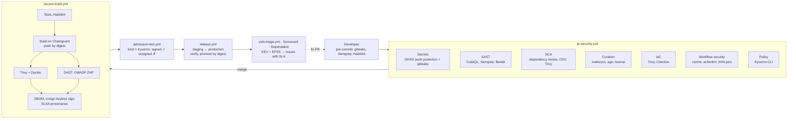

# Paved Road Platform

One central, versioned set of GitHub Actions reusable workflows and policies that builds security
into the software supply chain of every repository in the **Triorex** organization: about 80
repositories, from the developer's laptop to production.

App teams write one short `ci.yml` that calls these workflows at a pinned commit. Every control
(secret scanning, SAST, SCA, package curation, IaC, workflow security, policy as code, DAST, SBOM,
signing, provenance, admission control and release) runs from here, so a platform release changes
the whole fleet without touching 80 repos.

> Design document with the full architecture diagram: [`docs/design.html`](docs/design.html)



## What is in this repository

| Path | Purpose |
|---|---|
| `.github/workflows/pr-security.yml` | All PR gates in parallel; one required check: `pr-security / gate` |
| `.github/workflows/secure-build.yml` | Test → build → scan → DAST → SBOM, sign, attest (signing runs last) |
| `.github/workflows/admission-test.yml` | Throwaway kind + Kyverno cluster proves signed images run and unsigned ones are denied |
| `.github/workflows/release.yml` | Verify signature, SBOM attestation and provenance; promote one digest per environment |
| `.github/workflows/vuln-triage.yml` | Alerts → CISA KEV + EPSS → GitHub Issues with SLA due dates; closes on clean rescan |
| `security/security-policy.yml` | Every threshold and audit/enforce mode, for the whole fleet |
| `security/semgrep/`, `gitleaks.toml`, `zap-rules.tsv` | Org-specific scanner rules |
| `policies/kyverno/` | Admission policy (signature) and workload baseline, with policy unit tests |
| `policies/jfrog/` | Enterprise artifact front door: repos, Curation, Xray (design) |
| `governance/` | Org governance as code: teams, custom properties, security configuration, Actions policy, OIDC subject, ruleset |
| `fleet/` | 80-repo inventory, onboarding, compliance and adoption report, app-repo templates |
| `infra/terraform/` | AWS production target: OIDC deploy role, ECR, KMS (design, scanned in CI) |
| `scripts/` | Gate logic (curation, exceptions, SARIF gate, pin check, triage) and the demo |
| `docs/` | Plan, design, decision records |

## Onboarding a repository

```yaml
# .github/workflows/ci.yml (rendered by fleet/onboard.py from fleet/templates/ci.yml.tmpl)
jobs:
  pr-security:
    name: pr-security
    uses: Triorex/paved-road-platform/.github/workflows/pr-security.yml@<commit-sha> # v1.0.0
    with:
      codeql-languages: '["python","actions"]'
    permissions: { contents: read, id-token: write, security-events: write, pull-requests: write, actions: read }
```

Then set the repo's custom properties (`paved-road=true`, `ring`, `risk-tier`). The org ruleset
and the `paved-road-baseline` security configuration apply automatically.

## Design rules

- **One gate per finding class.** Trivy is the gate for SCA, IaC and images; OSV-Scanner and
  Checkov report. Everything uploads SARIF, so the Security tab is the single place to triage.
- **Audit before enforce.** Every gate reads its mode from `security-policy.yml`.
- **Pinned everything.** Actions by commit SHA (enforced by the org Actions policy and zizmor),
  images by digest, tools by version, with a 7-day release cooldown, the same rule the curation
  gate applies to app dependencies.
- **No long-lived secrets.** OIDC for Sigstore, GHCR, JFrog and AWS.
- **Unsigned means undeployable.** Signing is the last build step; the cluster trusts one signer.
- **Self-locating workflows.** Each reusable workflow reads `job_workflow_sha` from its OIDC token
  and loads policy and scripts from that exact platform commit, so pinning one SHA pins everything.

## Releases: only proven versions reach production

- **Apps:** a digest is promoted by exact copy, and the tag is checked against the signed digest.
  Production requires a signed promotion to staging. A GitHub Release exists only for what reached
  production. Unpromoted images are cleaned up weekly.
- **Platform:** versions ship as `vX.Y.Z-rc.N` to ring 0; `promote-release.yml` cuts the final
  `vX.Y.Z` on the same commit only after ring-0 production evidence. Defective versions are marked
  `[WITHDRAWN]` and flagged by the fleet report. See `docs/adr/0003`.

## Local commands

```sh
make setup test lint policy-test      # tooling, unit tests, workflow lint, Kyverno policy tests
make governance-plan                  # what org governance would change (read-only)
make fleet-plan PLATFORM_SHA=<sha> PLATFORM_VERSION=v1.0.0
make fleet-report                     # adoption across the fleet
make demo SIGNED=ghcr.io/triorex/payments-api@sha256:<digest>
make verify REF=ghcr.io/triorex/payments-api@sha256:<digest>
```

## Live versus design

Everything above runs live except: JFrog (wired in behind `JFROG_ENABLED`, config in
`policies/jfrog/`), the AWS target (`infra/terraform/`), runtime detection (Falco, Wiz), and
self-hosted runners. See `docs/design.html` §9.
